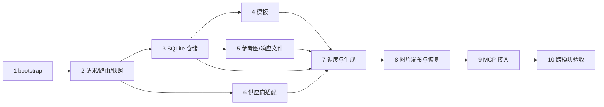

# 实施依赖与关键路径

本图依据 tasks.md 的逻辑依赖整理；没有工作量或工期估算，故是**依赖关键链**，不是经过工期计算的 CPM 最长路径。实际进度以 tasks.md 为准。

执行安排：

- 仓储子代理负责 3.2–3.6，然后执行第 7 组；幂等查找、快照准备、事务入库和未引用文件清理须共用 admission 锁。
- 文件子代理负责第 5 组，然后执行第 8 组的可独立完成部分；响应须在解析前完整持久化并登记。
- 供应商子代理负责第 6 组，然后进行第 9 组接入准备；未完成的工具不能返回虚假成功。
- 主代理负责模板、协调接口、复核和任务记录；调度、文件和 MCP 汇合后完成第 10 组验收。

注意：2.2 的重试固定通道依赖第 7 组实际执行；2.5 和 4.2 的真实快照复用依赖仓储、模板和 admission 集成。5.2/5.3、6.1/6.5、3.2/3.3 等带跨模块验收的任务须等集成证据，不能仅凭独立组件测试勾选。Codex 的验证与供应商收费验证按 tasks.md 记录实际结果和既有授权边界。
